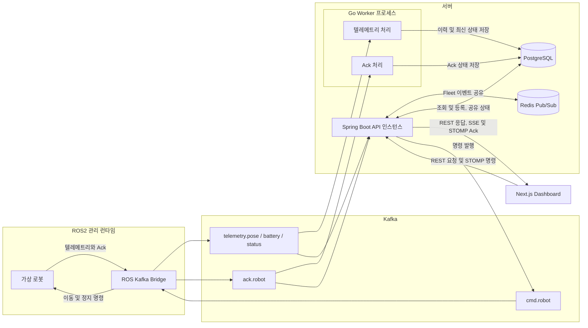

# Robot Telemetry Platform

로봇 텔레메트리 수집, 저장, 실시간 스트리밍, 제어 명령 전송을 한 저장소에서 다루는 모노레포입니다.  
ROS2 기반 가상 로봇이 텔레메트리를 발행하면 Kafka를 통해 Go Worker와 Spring API가 이를 처리하고, Next.js 대시보드가 실시간 상태 조회와 명령 전송 UI를 제공합니다.

## 요약


- ROS2 가상 로봇과 Kafka 브릿지를 통해 로봇 텔레메트리와 명령을 비동기 처리합니다.
- Go Worker가 Kafka 메시지를 배치 적재하여 PostgreSQL에 저장합니다.
- Spring Boot API가 REST, SSE, WebSocket(STOMP)로 대시보드와 로봇 네트워크를 연결합니다.
- Next.js 대시보드가 Fleet Overview, 개별 로봇 상세, 배터리/위치 이력, 명령 패널을 제공합니다.


## 아키텍처

Kafka를 중심으로 이력 저장과 실시간 전달을 분리합니다. PostgreSQL은 이력과 공유 상태를
저장하고, Redis는 API 인스턴스 사이에서 실시간 이벤트를 전달합니다.



### 데이터 흐름

1. **수집과 저장:** 로봇의 pose, battery, status와 Ack를 Bridge가 Kafka에 전달합니다.
   Worker는 텔레메트리와 Ack를 별도 Consumer 및 DB 풀로 처리하고, PostgreSQL에
   중복 없이 적재합니다. DB 장애로 대기 상한에 도달하면 소비를 멈추고 복구 후 재개합니다.
2. **실시간 관제:** API가 Kafka 이벤트를 받아 Redis의 Fleet 채널로 공유합니다.
   각 API는 자신에게 연결된 화면에 SSE로 텔레메트리를, STOMP로 Ack를 전달합니다.
   화면은 REST로 초기 상태와 저장된 이력을 조회합니다.
3. **로봇 제어:** 화면의 STOMP 명령은 API에서 검증한 뒤 `cmd.robot`을 통해 Bridge와
   로봇으로 전달됩니다. 로봇의 실행 결과는 `ack.robot`을 거쳐 저장되고 화면에 반영됩니다.
   명령 접수 응답과 로봇의 실행 완료 Ack는 구분합니다.
4. **로봇 추가와 삭제:** 화면이 API의 등록 목록을 변경하면 ROS 관리 노드가 내부 API를
   조회해 로봇과 Bridge 연결을 추가하거나 제거합니다. Fleet당 관리 런타임은 하나이며,
   재시작하면 DB에 저장된 설정으로 복구합니다.

### 영속 전달과 확장 경계

- API 인스턴스는 PostgreSQL의 공유 상태와 Redis 이벤트 전달을 사용해 연결 서버에
  관계없이 로봇 상태를 조회하고 실시간 이벤트를 받을 수 있습니다.
- Worker를 늘리면 같은 consumer group 안에서 Kafka 파티션을 나눠 처리합니다.
  파티션별 순서를 유지하며, 저장이 끝난 위치만 커밋하고 재할당 후 미완료 메시지를 재처리합니다.
- 선택적인 명령 영속 경로를 켜면 PostgreSQL outbox와 ROS의 SQLite 저널로 명령 및 Ack를
  보관하고 재전송합니다. **기본 설정은 비활성화**입니다.

상세 구조는 [ARCHITECTURE.md](ARCHITECTURE.md), 메시지 계약은
[Telemetry 도메인](docs/domain/telemetry.md), 설계 결정은 [ADR](docs/decisions/)에서 확인할 수 있습니다.
[명령 영속 전달](docs/features/durable-command-delivery.md)과
[Worker 부하 제어](docs/features/worker-backpressure.md)에 장애 복구 범위와 검증 결과를 기록했습니다.

## 패키지 구조

```text
.
├── infra/                  # Docker Compose, Kafka 토픽 초기화 스크립트
├── ros/                    # ROS2 fake_robot, ros_kafka_bridge
├── services/
│   ├── api/                   # Spring Boot API, SSE, WebSocket, Swagger
│   ├── worker/                # Kafka Consumer + PostgreSQL batch writer
│   └── dashboard/             # Next.js 대시보드
├── scripts/                # 개발/테스트/빌드 보조 스크립트
├── contracts/              # 메시지/도메인 계약 관련 자산
└── docs/                   # PR 초안 등 문서
```

## 서비스 구성

| 영역 | 경로 | 역할 | 주요 기술 |
| --- | --- | --- | --- |
| ROS2 | `ros/` | 가상 로봇 시뮬레이션, Kafka 브릿지 | ROS2 Humble, Python |
| API | `services/api/` | REST, SSE, WebSocket, Kafka integration | Spring Boot 3.5, Java 25 |
| Worker | `services/worker/` | Kafka consume, PostgreSQL batch insert, DLQ 처리 | Go 1.22, pgx, confluent-kafka-go |
| Dashboard | `services/dashboard/` | 실시간 관제 UI, 로봇 상세, 명령 패널 | Next.js 16, React 19, Zustand |
| Infra | `infra/` | PostgreSQL, Redis, Kafka, Zookeeper, fake robot 컨테이너 | Docker Compose |

## 실행 방법

### 사전 준비

- Docker / Docker Compose
- 각 서비스를 호스트에서 별도로 실행할 경우에만 Java 25, Go 1.22+, Node.js 20+ 및 `pnpm`

### 1. 환경 변수 준비

```bash
cp .env.example .env
```

기본값만으로도 로컬 실행이 가능합니다.

### 2. 전체 개발 환경 실행

```bash
./scripts/dev.sh up
```

스크립트는 다음 Compose 명령을 실행합니다.

```bash
docker compose -f infra/docker-compose.yml up -d --build
```

PostgreSQL, Kafka/Zookeeper, Kafka 토픽 초기화, Spring API, Go Worker, ROS2 가상
로봇, Next.js Dashboard가 의존성과 헬스체크 순서에 맞게 실행됩니다.

### 3. 접속 주소

- Dashboard: `http://localhost:3000`
- Spring API: `http://localhost:8080`
- Swagger UI: `http://localhost:8080/swagger-ui/index.html`
- Kafka: `localhost:9092`
- PostgreSQL: `localhost:15432`

### 4. 상태 확인과 종료

```bash
./scripts/dev.sh ps
```

```bash
./scripts/dev.sh down
```

로그만 보고 싶다면:

```bash
./scripts/dev.sh logs
```

## 수동 실행

### 인프라만 실행

```bash
docker compose -f infra/docker-compose.yml up -d postgres kafka kafka-topic-init
```

### Go Worker 실행

```bash
cd services/worker
go run ./cmd/...
```

기본 환경 변수:

- `POSTGRES_HOST=localhost`
- `POSTGRES_PORT=15432` (Compose PostgreSQL 사용 시)
- `POSTGRES_USER=postgres`
- `POSTGRES_PASSWORD=postgres`
- `POSTGRES_DB=telemetry`
- `KAFKA_BROKER_URL=localhost:9092`
- `KAFKA_GROUP_ID=telemetry-worker`
- `KAFKA_TOPICS=telemetry.pose,telemetry.battery,telemetry.status,ack.robot`
- `DLQ_TOPIC=dlq.telemetry`

### Spring API 실행

```bash
cd services/api
./gradlew bootRun
```

### Next.js Dashboard 실행

```bash
cd services/dashboard
pnpm dev
```

필요하면 API 주소를 명시적으로 지정할 수 있습니다.

```bash
NEXT_PUBLIC_API_URL=http://localhost:8080 pnpm dev
```

### ROS2 fake_robot 실행

```bash
docker compose -f infra/docker-compose.yml up fake_robot --build
```

ROS2 CLI 테스트는 컨테이너 내부에서 수행합니다.

```bash
docker exec -it robot_fake_nodes bash
source /opt/ros/humble/setup.bash
export ROS_LOCALHOST_ONLY=1
```

## 핵심 토픽

| 토픽 | 설명 |
| --- | --- |
| `telemetry.pose` | 로봇 위치 텔레메트리 |
| `telemetry.battery` | 로봇 배터리 텔레메트리 |
| `telemetry.status` | 로봇 상태 텔레메트리 |
| `cmd.robot` | 대시보드/백엔드에서 로봇으로 전달하는 명령 |
| `ack.robot` | 로봇이 반환하는 명령 Ack |
| `dlq.telemetry` | Worker 처리 실패 메시지의 DLQ |

## 개발 보조 스크립트

| 스크립트 | 설명 |
| --- | --- |
| `scripts/dev.sh` | Compose 전체 환경 실행/중지/로그/상태 조회 |
| `scripts/build-worker.sh` | Worker Docker 이미지 빌드 |
| `scripts/test-worker.sh` | Worker Go 테스트 실행 |
| `scripts/reset-test-env.sh` | Kafka/Postgres 및 Worker 테스트 환경 초기화 |

## 서비스별 문서

- [infra/README.md](infra/README.md)
- [ros/README.md](ros/README.md)
- [services/api/README.md](services/api/README.md)
- [services/dashboard/README.md](services/dashboard/README.md)
